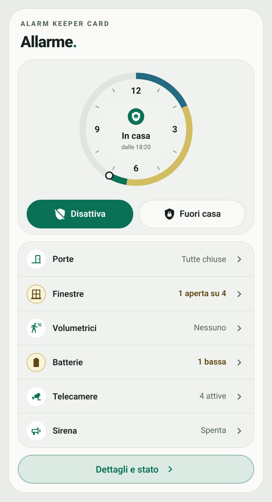
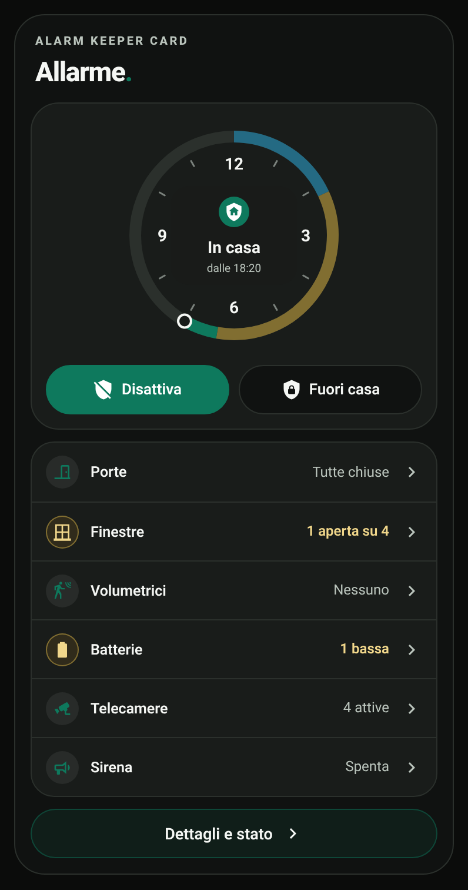
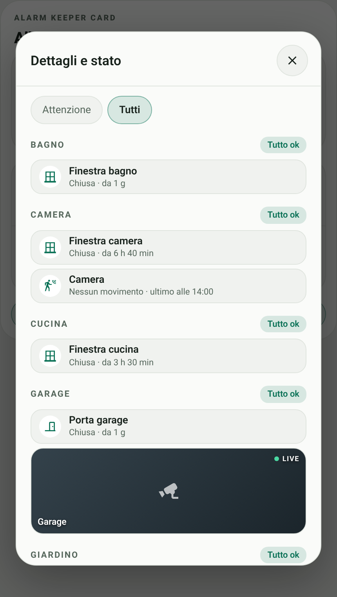
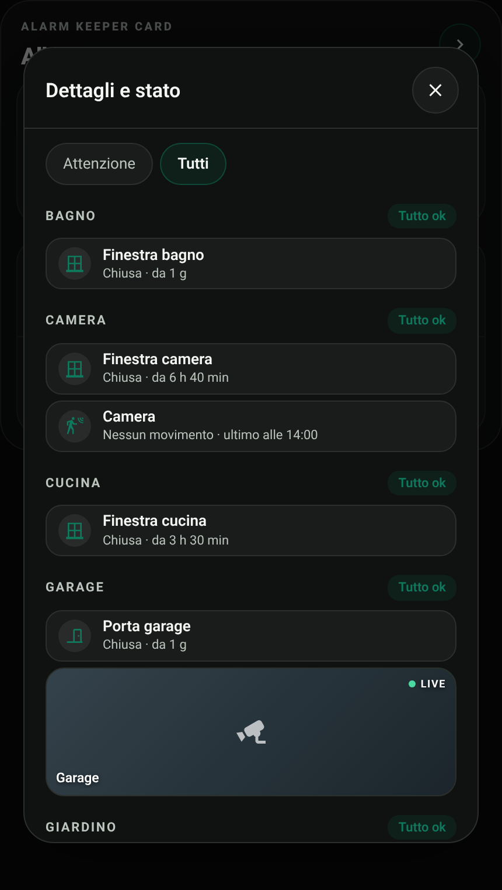

# Alarm Keeper Card — français québécois

Carte d’alarme modulaire pour les tableaux de bord Home Assistant. Cette adaptation en français québécois du [projet original de luigi-regolo](https://github.com/luigi-regolo/alarm-keeper-card) date du 18 novembre 2026.

## Aperçu

La carte reprend l’apparence Edera claire et sombre. Le cadran de 12 heures indique l’activité de la journée jusqu’à l’heure actuelle. Les commandes et les tuiles donnent accès à l’alarme et aux appareils associés. La fenêtre de détails met en évidence les éléments à vérifier et les regroupe par pièce.

  
  

  
  

Les captures du projet d’origine illustrent la disposition avec des données de démonstration.

## Prérequis

- Une installation Home Assistant qui accepte les cartes JavaScript personnalisées.
- Une entité `alarm_control_panel` pour afficher le panneau d’alarme.
- L’historique de cette entité, enregistré par l’intégration Recorder, pour afficher les périodes d’armement. Sans historique accessible, le cadran indique uniquement l’état actuel.
- Les entités correspondant aux modules souhaités. La carte utilise les domaines et classes d’appareils de Home Assistant et fonctionne sans abonnement ni bibliothèque JavaScript externe.

## Installation

Si la carte d’origine est déjà installée, remplacez sa ressource JavaScript par celle du fork. Les deux versions utilisent le même type de carte et la même configuration. Une seule ressource Alarm Keeper Card doit être chargée.

### Marketplace de Home Assistant (2026.11 et plus récent)

1. Ouvrez **Paramètres → Marketplace**.
2. Choisissez **Ajouter à partir d’un lien** et collez `https://github.com/fredct15/alarm-keeper-card`.
3. Connectez GitHub si le Marketplace le demande. Si le type doit être choisi manuellement, sélectionnez **Tableau de bord**.
4. Ouvrez la fiche du dépôt ajouté, puis sélectionnez **Installer**.
5. Actualisez le tableau de bord et ajoutez **Alarm Keeper Card** dans l’éditeur.

[Documentation du Marketplace](https://www.home-assistant.io/integrations/marketplace/#custom-repositories)

### HACS (installations qui utilisent encore HACS)

1. Ouvrez **HACS → ⋮ → Dépôts personnalisés**.
2. Ajoutez `https://github.com/fredct15/alarm-keeper-card` dans la catégorie **Tableau de bord** (appelée **Lovelace** ou **Plugin** dans certaines versions).
3. Ouvrez la fiche du dépôt et téléchargez la carte.
4. Actualisez le tableau de bord et ajoutez **Alarm Keeper Card**.

[Documentation HACS](https://www.hacs.dev/docs/use/repositories/dashboard/)

### Installation manuelle

1. Téléchargez [alarm-keeper-card.js](https://raw.githubusercontent.com/fredct15/alarm-keeper-card/main/dist/alarm-keeper-card.js).
2. Copiez-le dans le répertoire `www` de votre configuration Home Assistant (habituellement `/config/www/`). Si vous venez de créer ce répertoire, un redémarrage de Home Assistant peut être requis.
3. Ouvrez **Paramètres → Tableaux de bord → ⋮ → Ressources**. Selon le profil, activez le **Mode avancé** pour afficher ce menu.
4. Ajoutez `/local/alarm-keeper-card.js` comme **module JavaScript**.
5. Actualisez le tableau de bord. En mode édition, ajoutez **Alarm Keeper Card**.

## Configuration

Dans l’éditeur visuel de la carte, utilisez les sections suivantes.

- **Alarme** pour choisir l’entité, afficher le panneau, activer les commandes et régler la légende et les aiguilles.
- **Modules** pour activer ou masquer les modules, choisir leurs entités et régler leur ordre. **Ajouter depuis une pièce** propose les entités compatibles de cette pièce qui ne sont pas encore sélectionnées. L’option **Afficher une tuile dans la carte** contrôle le résumé du module lorsque le panneau est actif.
- **Apparence** pour personnaliser le titre, le surtitre, le thème et la largeur sur tablette et ordinateur. La carte peut rester centrée ou occuper toute la largeur. À pleine largeur, les commandes et le cadran restent à gauche, et les modules s’affichent à droite.

Pour placer un seul module dans le tableau de bord, désactivez le panneau dans **Alarme** et laissez uniquement ce module actif. Vous pouvez ajouter plusieurs cartes pour répartir les modules à différents endroits. Un module sans entités reste masqué.

## Utilisation

- **Cadran**. Le vert indique le mode **À domicile**, le bleu le mode **Absent**, et le jaune les périodes désarmées. Le point marque l’heure courante. Touchez le cadran pour afficher la légende et la durée totale d’armement aujourd’hui.
- **Armement et désarmement**. Les boutons **À domicile**, **Absent** et **Désarmer** apparaissent selon l’état de l’alarme. L’option **Activer les commandes** permet de mettre le panneau en lecture seule.
- **Clavier**. Le désarmement ouvre toujours le clavier. L’armement demande un code si l’entité l’exige. Home Assistant valide le code, qui est saisi chaque fois et jamais conservé par la carte. Si aucun code n’est configuré, le clavier affiche un avis et la commande peut être envoyée sans code. Configurez un code sur l’entité si d’autres personnes ont accès au tableau de bord.
- **Détails et état**. Ouvrez la fenêtre depuis l’en-tête, une tuile ou le bouton sous les tuiles lorsque l’en-tête est masqué. **À vérifier** présente les éléments qui nécessitent de l’attention. **Tous** affiche toutes les entités. La carte utilise la pièce attribuée à l’entité ou à l’appareil. Les éléments sans pièce sont regroupés par type. Lorsqu’ils partagent le même appareil, certains capteurs, réglages et volumes sont affichés sous la sirène ou la centrale.

| Module | Utilisation |
| --- | --- |
| Portes et fenêtres | Affiche l’ouverture ou la fermeture et le temps depuis le dernier changement. |
| Mouvement | Affiche l’activité et l’heure du dernier mouvement. |
| Sabotage | Indique les alertes signalées par les capteurs de sabotage. |
| Batteries | Affiche la charge et indique les batteries faibles. |
| Centrale | Affiche l’état des entités associées à la centrale. |
| Sirène | Permet d’activer ou d’arrêter la sirène après confirmation. |
| Caméras | Ouvre la fenêtre de détails native de Home Assistant lorsque vous touchez une caméra. |
| Volumes | Verrouillés à l’ouverture. Touchez le cadenas d’un volume, ajustez-le avec les boutons moins ou plus, puis verrouillez-le de nouveau. |
| Paramètres | Affiche les options fournies par les entités `select`, par exemple le contournement et les sons. |

Les domaines utilisés sont `alarm_control_panel`, `binary_sensor`, `sensor`, `switch`, `siren`, `camera`, `number` et `select`. La carte conserve les services d’origine `alarm_control_panel.alarm_disarm`, `alarm_control_panel.alarm_arm_home`, `alarm_control_panel.alarm_arm_away`, `switch.turn_on`, `switch.turn_off`, `siren.turn_on`, `siren.turn_off`, `number.set_value` et `select.select_option`.

## Compatibilité et limites

- L’interface de la carte est en français québécois. Les contrôles natifs suivent la langue de Home Assistant. Les noms des entités et des pièces, les titres déjà enregistrés et les valeurs fournies par les intégrations conservent leur texte d’origine.
- La version minimale de Home Assistant compatible avec la carte n’a pas été établie. La syntaxe et les commandes ont été vérifiées hors d’une installation Home Assistant. L’installation par HACS et Marketplace, le rendu dans un vrai tableau de bord et le comportement des appareils physiques restent à valider.
- Cette carte affiche les états signalés par les entités. Une information manquante, inconnue ou indisponible ne confirme pas qu’un appareil ou une propriété est en sécurité.

## Confidentialité et sécurité

La carte utilise les entités et les permissions de l’utilisateur connecté à Home Assistant. Elle envoie les commandes à la suite d’une action de l’utilisateur. Elle ne conserve pas le code d’alarme et n’inclut ni publicité, ni mesure d’audience, ni télémétrie, ni suivi des utilisateurs.

**Alarm Keeper Card n’est pas un système certifié de sécurité, de détection d’intrusion ou de contrôle d’accès.**

## Versions, crédits et licence

Les versions publiées se trouvent dans les [releases GitHub du fork](https://github.com/fredct15/alarm-keeper-card/releases). Le fichier à installer est `dist/alarm-keeper-card.js`.

Copyright © 2026 luigi-regolo. Projet original créé et maintenu par **luigi-regolo**.

Distribué selon les termes de la **Licence publique générale GNU, version 3 uniquement (GPL-3.0-only)**. Consultez le fichier [LICENSE](LICENSE) pour les conditions complètes. Le logiciel est fourni sans garantie dans les limites permises par la loi.
